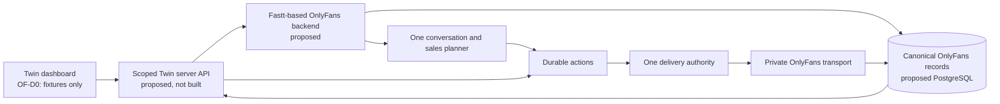

# OF-D0: OnlyFans dashboard architecture

Status: OF-D0 scaffold. Isolated, fixture-based, no backend integration. Nothing
in this document describes a running system. Every endpoint named in
API_CONTRACTS.md is a proposal, not an existing route.

Prepared 17 October 2026 in the isolated checkout `twin-dashboard-of-d0`
(worktree of `twin-dashboard`, branch `codex/onlyfans-dashboard-foundation`,
base `fb6b345`).

Authoritative references, in the order the handover sets out:

- `twin-sexbot/docs/onlyfans/DASHBOARD_HANDOVER.md` (this assignment).
- `twin-sexbot/docs/onlyfans/CONSOLIDATION_PLAN.md` (OnlyFans backend target).
- `output/independent-audit-20261016/COMPARATIVE-AUDIT.md` (findings).
- `twin-sexbot/docs/telegram/IMPLEMENTATION_PLAN.md` and its START_HERE /
  PROGRESS / REVIEW_FINDINGS (the parallel Telegram track).
- `inflowwkiller/service/native_pilot/README.md` (the native text experiment).

`twin-sexbot/docs/onlyfans/IMPLEMENTATION_PLAN.md` is the historical Twin V2
bridge plan and is not the current direction.

## 1. What OF-D0 is, and what it is not

It is one Twin CRM that will host several channels, with the OnlyFans accounts
and inbox surfaces built against synthetic fixtures so the look and the workflow
can be reviewed before any backend exists.

It is not: a live integration, a second application, a second design system, a
Fastt frontend, a replacement for the Telegram workspace, or evidence that the
consolidated OnlyFans backend is ready. No OnlyFans account is connected, no
message is sent, no setting is persisted and no money moves anywhere in OF-D0.

## 2. Screen map

One workspace selector at the top level, one creator selection shared by every
channel, and then channel-specific surfaces.

| Workspace | Surface | State in OF-D0 |
|---|---|---|
| All channels | Overview | The route exists and is gated to operators; the screen is a labelled outline, because the earnings contract it needs is not real. |
| All channels | Earnings | Existing Twin route. Pointed at, not reproduced. |
| All channels | Creators, Platforms | Existing Twin routes. Pointed at, not reproduced. |
| Telegram | Fans and Messages | The existing `/users` combined screen. Pointed at, not reproduced. |
| Telegram | Flows, Media, AI, Business | Existing Twin routes. |
| OnlyFans | Accounts | Built in OF-D0 (fixtures). |
| OnlyFans | Inbox | Built in OF-D0 (fixtures). |
| OnlyFans | Content, Sales, Settings | Planned. The route exists and answers with the stage it belongs to; the navigation entry stays inert. |

Every surface above is a real route in the app, not a preview-only path. The two
channel workspaces and the combined overview are gated server-side by
`lib/channel-scope.ts`: a session that may not open a workspace is refused at the
route (404) and is never offered the channel in the switch. All channels is the
existing dashboard, so every session keeps it exactly as it was.

The OnlyFans sidebar shows only the two built surfaces plus the planned entries.
A planned entry renders as inert text with a tag rather than as a control,
because a navigation item that looks clickable and does nothing is the same
defect class as a configured-but-inert setting. Its route exists so a bookmark
answers honestly instead of 404ing.

## 3. Ownership: one owner per fact

The dashboard renders projections and submits commands. It never becomes a
second writable ledger.

| Fact or action | Sole authority | What the dashboard may do |
|---|---|---|
| Agency membership, operator identity | Existing Twin identity system, verified server-side | Render, and derive scope. Never decide it |
| Creator to OnlyFans account binding | Server-managed binding, tenant and channel scoped | Request a scope by browser id. Never grant it |
| Inbound and confirmed outbound history | Canonical relational messages with provider identity | Read a projection only |
| Fan facts and creator persona | Versioned facts with provenance and correction rules | Display provenance. Submit corrections as commands |
| Conversation control (mode, revision, unresolved send) | One durable control record per conversation | Display. Submit revision-bound commands |
| Reply and sales decisions | One selected planner per conversation turn | Not touched by the dashboard at all |
| Delivery and retries | Shared send-intent and attempt service | Display per-bubble receipts. Request evidence resolution |
| Purchases, refunds, ownership | Confirmed commercial events | Display with currency. Never compute its own totals |
| Pricing and caps | One versioned policy, read by planner and sender | Display. Submit a proposed change as a command |

Two separation rules are carried in the frontend types themselves:

- An OnlyFans fan is never stored in a `telegram_id`. OF fan identity is its own
  account-scoped string, and two accounts never share one.
- OnlyFans money is never a Stars column. Money is `{ currency, minorUnits }`,
  an integer count of minor units with an explicit ISO-4217 currency, and
  nothing converts between currencies or between a currency and a Stars balance.

## 4. Request flow the dashboard is designed against

The dashboard sits on the left of that diagram and nowhere else. It has no path
to the transport, no path to the planner and no path to the database.

## 5. Authentication and account binding (proposed)

None of this is implemented. It is the contract every later OnlyFans endpoint
must satisfy, and it is why the preview refuses to invent its own access model.

- Authentication is the existing Twin identity system. No second login, no
  dashboard-owned session table, no duplicate invite system.
- Authorization is derived server-side from the authenticated identity plus a
  server-owned creator and account binding. A browser-supplied account id is a
  scope request and never a grant.
- `getDashboardAccess()` returns null in some independently authenticated
  internal contexts, so a null is not admin authorization. Every OnlyFans
  endpoint must validate authentication and account-level authorization
  explicitly. A middleware development shortcut is not a boundary.
- A view-as session is read only and narrower than the operator. The preview
  models this: `readOnlyView(accountIds)` produces `canManage: false` and a
  smaller scope, and the command guard refuses before any handler runs.
- No provider session material, cookie, service-role key or unrestricted relay
  credential may reach the browser. The dashboard needs projections, not
  credentials.

## 6. The state model

Five dimensions are independent, and the preview keeps them that way. Connected
does not mean replying. Paused does not mean failed. Delivered does not mean
read, and never means purchased.

| Dimension | Values | Where it lives |
|---|---|---|
| Permission | operator, view-as (read only) | Viewer |
| Connection health | connected, reconnecting, disconnected, expired_session, revoked | Account |
| Automation mode | automated, human_controlled, paused, no_contact | Conversation |
| Takeover | none, requested, effective | Conversation |
| Delivery | none, generating, queued, dispatching, sent, partial, unknown, refused, failed | Per message and per conversation |

Separately, and not a sixth dimension of the same kind:

| Read state | Meaning |
|---|---|
| loading | Asked for, not answered yet |
| empty | Answered, and there is genuinely nothing |
| error | The read failed. No value is shown rather than a guess |
| stale | A last known value, labelled and carrying its own age |
| ready | A current value |

Empty, unavailable and zero are three different things and are never collapsed. A
stale value can never silently become current: freshness is on every read state
that holds data.

### 6.1 What the controls do, by state

The rule that matters most: an unresolved send has no resend. It has an evidence
resolution path. Guessing that a request failed is how a fan receives the same
message twice.

An unresolved send blocks *conflicting sends*, not every control. It withdraws
exactly the two actions that could dispatch another message — sending a manual
message and resuming automation — and leaves the actions that only reduce
activity (pause, takeover, no-contact) available, because during an uncertain
send those are the safe direction. This is the consolidation plan's rule
("unknown outcomes pause conflicting work", and unresolved delivery "blocks
conflicting sends regardless of mode") read precisely: it is about sends, not
about freezing the conversation.

| Situation | Send | Pause / resume | Takeover | Resolve evidence |
|---|---|---|---|---|
| Connected, automated, no unresolved send | yes | yes (pause) | yes | only if an incident exists |
| Connected, paused by the owner | yes | yes (resume) | yes | only if an incident exists |
| A human has control | yes | yes (resume) | yes (hand back) | only if an incident exists |
| Expired session, disconnected or revoked | no, with reason | no, with reason | no, with reason | no, with reason |
| Unresolved send (dispatching or unknown) | no, with reason | pause yes; resume no, with reason | yes | yes |
| No further contact requested | no, with reason | no | no | only if an incident exists |
| Capability not configured or unavailable | no, with reason | as advertised | as advertised | as advertised |
| View-as (read only) | no, with reason | no, with reason | no, with reason | no, with reason |

Every withheld control shows its reason in the interface.

## 7. Feature availability in OF-D0

| Capability | OF-D0 | Later stage |
|---|---|---|
| Workspace, creator and account navigation | Demonstrated in the isolated preview | Shared shell change, OF-D1 or later |
| Accounts list with health, mode, capability, freshness | Fixture | Live reads, OF-D2 |
| Conversation list, cursor paging, thread, per-bubble receipts | Fixture | Live reads, OF-D2 |
| Fan facts with provenance, owned media | Fixture, display only | Live projections, OF-D4 |
| Pause, takeover, resume, no-contact, manual send | Modelled and refused | Real commands, OF-D3 |
| Delivery incident and evidence resolution | Modelled, no resend offered | Real workflow, OF-D3 |
| Content library, sales, settings, earnings | Not built | OF-D1, OF-D4 |
| Automation status per account and conversation | Displayed from fixtures | Backend capability flag, OF-D2 |

## 8. Dependency gates

OF-D0 completes nothing downstream. Each later stage is blocked on the backend
milestones in `CONSOLIDATION_PLAN.md`, not on this scaffold.

| Stage | Needs |
|---|---|
| OF-D1 | Reviewed contracts (this package), and a decision on the shared shell change |
| OF-D2 | Scoped read API, authorization, cursor pagination, storage foundations |
| OF-D3 | The single delivery and control authority, with retries, revisions and late receipts |
| OF-D4 | Canonical offers, purchases, refunds, ownership and capability contracts |
| OF-D5 | Deployment attestation, migration and rollback rehearsal, a bounded cohort |

Until those exist, every screen here stays on fixtures. There is no partial mode
where some fields are live and the rest are invented.

## 9. Where the code lives

| Path | Purpose |
|---|---|
| `lib/onlyfans-preview/types.ts` | View models and the workspace navigation model |
| `lib/onlyfans-preview/fixtures.ts` | Deterministic synthetic data, no clock, no randomness |
| `lib/onlyfans-preview/data-source.ts` | The one data-source interface, plus the refusing live source |
| `lib/onlyfans-preview/fixture-data-source.ts` | The fixture implementation and its scenario hooks |
| `lib/onlyfans-preview/selection.ts` | Account-scoped selection and staleness rules |
| `lib/onlyfans-preview/actions.ts` | Which controls a state admits, and why not |
| `lib/onlyfans-preview/scenarios.ts` | Preview-only state injection |
| `lib/onlyfans-preview/workspace.ts` | Workspaces, navigation model, creator index |
| `components/onlyfans-preview/*` | The preview surfaces, reusing `components/crm` presentation |
| `preview/onlyfans/*` | The isolated harness app, run separately |
| `scripts/check-onlyfans-preview.ts` | The fixture contract checks |
| `docs/onlyfans/*` | These documents |

Nothing in that list is imported by the live app.
